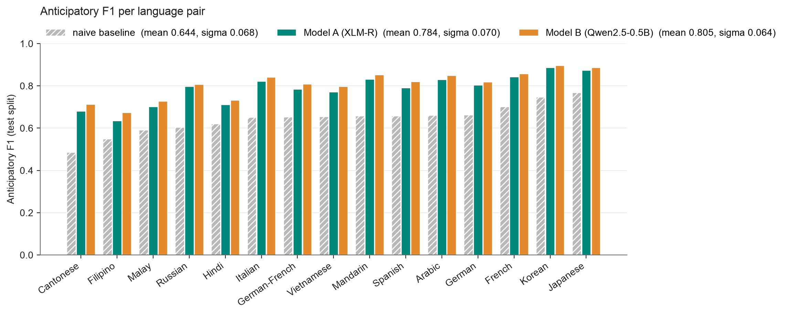
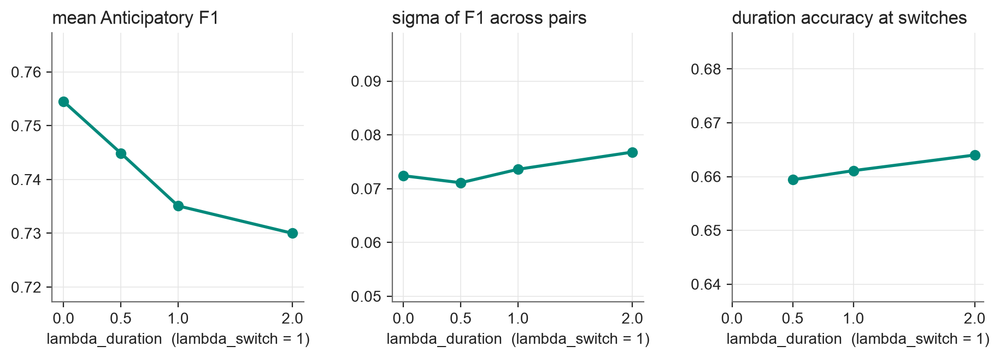
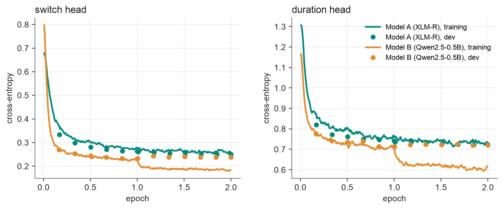

# Update 2 results

All numbers are on the test split (11,874 conversations, 15 language pairs) unless stated.
F1 is the anticipatory F1 of the switch class with a decision threshold tuned per pair on dev.
sigma is the population standard deviation of the 15 per-pair F1 values (smaller = more universal).
Training ran in Kaggle Notebooks on NVIDIA T4 GPUs in float16. No batch had a non-finite loss in any run.

## Experiment A: two backbones (all training data, 2 epochs, lambda_sw = lambda_dur = 1, class weights on)

| run | params | train min | mean F1 | sigma | F1 at 0.5 | duration acc | F1 tag | F1 inter | F1 intra |
|---|---|---|---|---|---|---|---|---|---|
| naive baseline (Update 1) | none | none | 0.644 | 0.068 | n/a | 0.617 | n/a | n/a | n/a |
| Model A: XLM-R base + causal mask | 277M | 41 (2 GPUs) | 0.784 | 0.070 | 0.714 | 0.694 | 0.842 | 0.833 | 0.682 |
| Model B: Qwen2.5-0.5B | 494M | 129 (1 GPU) | **0.805** | **0.064** | 0.745 | 0.704 | 0.859 | 0.853 | 0.710 |

* Both models beat the naive baseline clearly: +0.140 (A) and +0.161 (B) mean F1.
* Model B is ahead of Model A on all 15 pairs, on all three switch types and on duration accuracy, with a lower sigma.
  The lead is modest (0.021) and costs 1.8x the parameters, 3.2x the training time and 2x the peak GPU memory (10.2 vs 5.2 GB).
* Intra-sentential switches are the hardest type for both models.
* An earlier Model A run with 128-subword windows and 3 epochs (`run_logs/model_a_xlmr_window128_3ep`, before the duplicate
  filter) reached 0.788, so the 256-subword window did not lift F1.

Full table: [comparison.md](comparison.md). Per-pair numbers: [f1_by_pair.md](f1_by_pair.md).

## Universality audit

* Every pair improves. Model B gains from +0.112 (Hindi) to +0.226 (Cantonese) over the baseline.
* Best minus worst pair: 0.282 (baseline), 0.252 (A), 0.223 (B). Model B's lead over A is largest on the weakest pairs
  (Filipino +0.040, Cantonese +0.031).
* Filipino, Cantonese, Malay and Hindi stay the four weakest pairs for both models. They are the four pairs with the
  largest share of short switches (1 to 2 words: 36 to 52 percent of switches).

## Loss weighting (Model A, 2,000 training conversations per pair, 1 epoch, one seed)

| run | mean F1 | F1 at 0.5 | sigma | duration acc | final CE switch | final CE duration |
|---|---|---|---|---|---|---|
| lambda_dur = 0 (switch only) | **0.754** | 0.685 | 0.072 | n/a | 0.310 | n/a |
| lambda_dur = 0.5 | 0.745 | 0.683 | 0.071 | 0.659 | 0.321 | 0.815 |
| lambda_dur = 1 | 0.735 | 0.682 | 0.074 | 0.661 | 0.336 | 0.815 |
| lambda_dur = 2 | 0.730 | 0.674 | 0.077 | 0.664 | 0.345 | 0.810 |
| lambda_dur = 1, no class weights | 0.733 | 0.717 | 0.074 | 0.683 | 0.202 | 0.764 |
| duration only (lambda_sw = 0) | n/a | n/a | n/a | 0.657 | n/a | 0.839 |

* With this budget the duration task costs switch F1: 0.754 alone, 0.730 at lambda_dur = 2. The switch task helps the
  duration head only slightly (0.657 alone, 0.659 to 0.664 together).
* Class weights do not change the tuned F1 (0.733 vs 0.735); they only shift P(switch) upward (tuned thresholds 0.75 to
  0.90 with weights, 0.25 to 0.55 without), which is why F1 at 0.5 is higher without them.
* Single runs on a subset; differences are at most 0.025. To be confirmed on all data with three seeds.

## Convergence

Per run, with dev F1 and duration accuracy: [Model A](convergence_model_a__xlm_r.png), [Model B](convergence_model_b__qwen2_5_0_5b.png).

* Both heads fall steeply in the first 0.2 epochs and level off; the duration head ends higher.
* Model B's training loss drops when the second epoch starts while its dev loss stays flat (0.944 to 0.958): it starts to
  memorize. Model A's dev loss still falls slowly (1.004 to 0.974).
* Dev F1 still rose slightly in epoch 2 (+0.008 A, +0.006 B); the last checkpoint was the best for both.
* Checkpoint selection: selecting by dev F1 at threshold 0.5 picked step 500 for Qwen in the first run
  (`run_logs/model_b_qwen_first_run_select_f1_at_0.5`, test F1 0.777). Selecting by the tuned F1 (now the default,
  `--select_by f1_tuned`) gives 0.805.

## Streaming check

Feeding a conversation one word at a time gives the same P(switch) as one pass over the window: largest difference
5.1e-7 (Model A) and 3.0e-6 (Model B), float32, 5 test conversations each (`run_logs/*/streaming_check.md`).

## float16 vs bfloat16 on the T4 (40-step check, `run_logs/speed_*`)

| model | bfloat16 | float16 + loss scaling |
|---|---|---|
| XLM-R | 0.77 s/step | 0.41 s/step |
| Qwen2.5-0.5B | 3.07 s/step | 1.40 s/step |

## Files

* `run_logs/<run>/`: `config.json`, `summary.json`, `train_log.csv` (every 20 steps), `dev_log.csv` (every 500 steps),
  `test_metrics.csv` and `dev_metrics.csv` (per pair), `streaming_check.md`, `train.log`.
* Model checkpoints (`model.pt`, 0.5 to 1 GB) are not in the repository.
